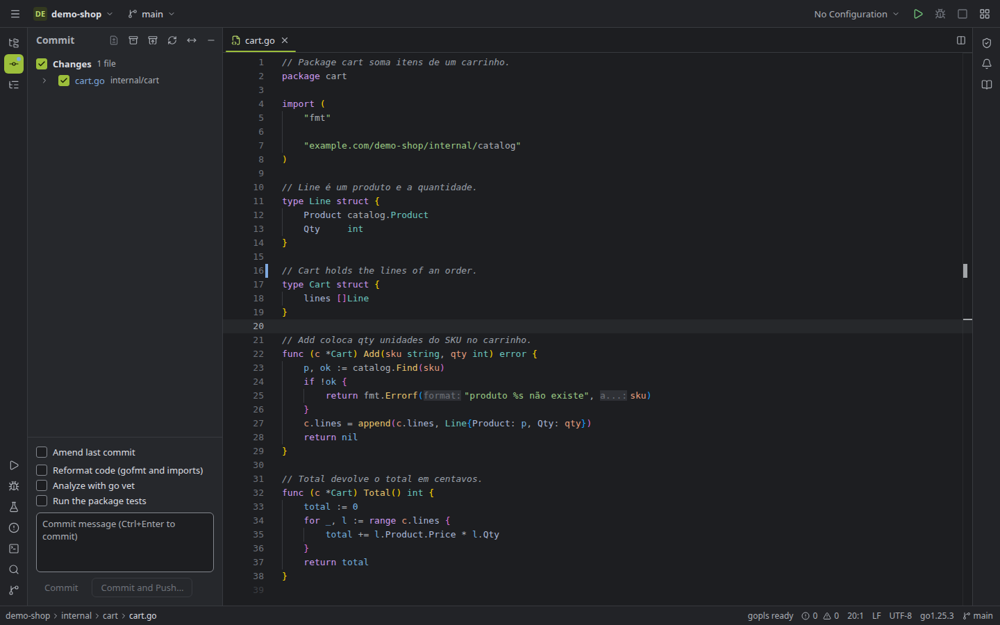
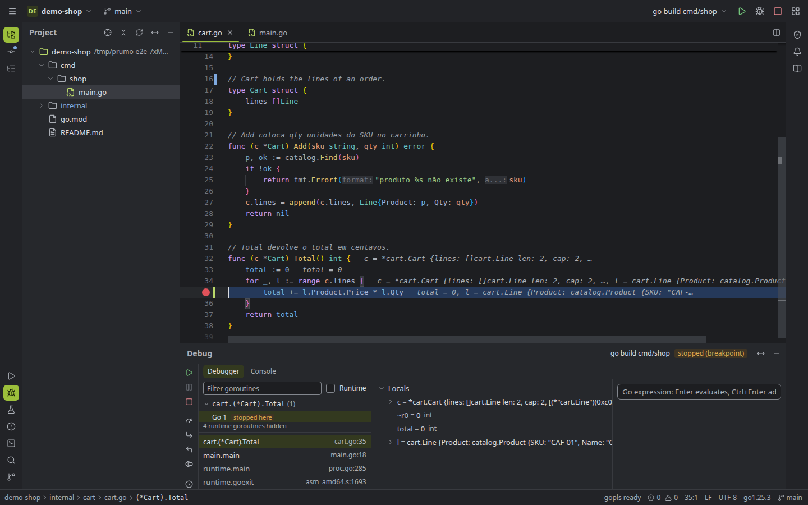
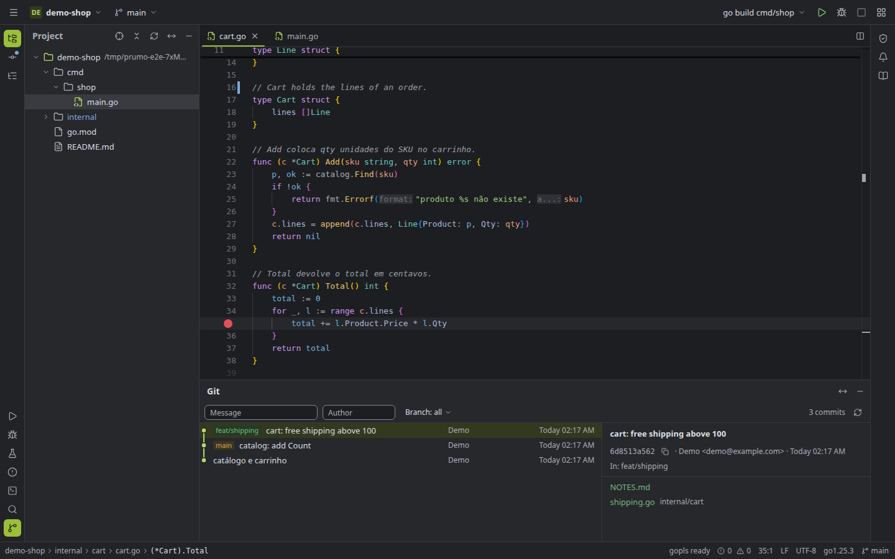

# Prumo

**A desktop IDE for Go, built from open parts.**

Prumo puts an editor, run configurations, a test runner, a debugger, a terminal and a full Git workflow in one
window, and gets its language smarts from the official, open tooling of the Go ecosystem: `gopls`, Delve,
`go test` and the `git` CLI you already have. No proprietary engine, no account, no telemetry.

> *Prumo* is Portuguese for a plumb line: the weighted string builders use to check that a wall is straight.



<p>
  
  
</p>

**Status:** early, usable, and tested. It is developed on Linux, where it is used day to day; macOS and Windows
builds are possible but have not been tested yet (see [Limitations](#limitations)). There are no prebuilt
releases yet: [the installer](#install) builds it from source in one step.

## Features

**Editor**
- Monaco editor wired to `gopls`: completion, hover docs, signature help, inlay hints, diagnostics and quick fixes
- Go to definition, implementation, type definition and super method; find usages grouped by read/write;
  peek definition and references; back/forward navigation and recent locations
- Rename with a multi-file preview, extract variable/function, inline call, change signature (move or remove a
  parameter), safe delete, implement interface, generate constructor and table-driven test
- Search Everywhere (files, symbols, actions), Find and Replace in Files with regex and scope
- Structure view, breadcrumbs, bookmarks with mnemonics, live templates, exit point highlighting,
  recursive call markers, split editor, and a diff viewer with side-by-side and unified modes

**Run, test, debug**
- Run configurations (Go Build and Go Test) with arguments, environment, working directory, build tags,
  stdin from a file, terminal emulation (colors and progress bars), and before-launch tasks (`go generate`,
  another configuration, or a command). Configurations can be stored in the project and shared through Git
- Test runner built on `go test -json`: a tree of packages, tests and subtests, rerun failed tests, run a single
  subtest, rerun on save, benchmarks and fuzz targets from the gutter
- Coverage in the gutter and per package and file, with merged coverage across runs
- Debugger built on Delve (DAP): breakpoints with conditions and log messages, stepping, run to cursor,
  variables, watches, evaluate expression, goroutines, inline values in the editor, and attach to a remote
  `dlv --headless`

**Git**
- Commit window with partial commits by hunk or by line, changelists, amend, commit message history, and
  optional gofmt, `go vet` and test checks before committing
- Branches (favorites, compare with the current branch, worktrees), update, push, stash, tags
- Log with a branch graph, filters and commit details; cherry-pick, revert, reset and interactive rebase from
  the log; blame in the gutter; a three-way merge tool for conflicts
- Tabs are remembered per branch

**Everything else**
- Integrated terminal (PTY), Problems window, notifications, editable keymap, settings with search
- Dark and light themes; English and Brazilian Portuguese
- Create a new Go module, clone a repository, download a Go SDK from go.dev (checked against the published
  SHA-256)
- Restricted mode for untrusted projects: nothing from the project runs until you trust it

## Install

There are no prebuilt releases yet. The installer builds Prumo from source and installs it for your user:

```bash
git clone <this repository> prumo && cd prumo
./install.sh
```

It checks the requirements, offers to install the missing system packages (asking before it uses `sudo`),
installs the UI dependencies, builds the UI and the app, puts `prumo` in `~/.local/bin` with a menu entry, and
offers to install `gopls` and `dlv` (Delve) if you don't have them. Run `./install.sh --help` for the options
(`--prefix`, `--yes`, `--no-tools`).

To remove it, run `./uninstall.sh`. Your settings, recent projects and breakpoints stay unless you add
`--purge` (it asks before deleting anything). Files inside your projects are never touched.

**Requirements:** Go 1.26+, Node.js 20.19+ (or 22.12+) and Git. On Linux, the GTK 3 and WebKitGTK development
packages (the installer can install them on Debian/Ubuntu, Fedora, Arch and openSUSE). On macOS, the Xcode
command line tools.

At run time Prumo uses the `go` and `git` on your `PATH`, plus `gopls` and `dlv` (it can also install those
later from Settings → Tools).

### Building by hand

```bash
sudo apt install libgtk-3-dev libwebkit2gtk-4.1-dev   # Debian / Ubuntu
cd frontend && npm ci && npm run build && cd ..
go build -tags desktop,production,webkit2_41 -o build/bin/prumo .   # drop webkit2_41 on macOS
```

With the [Wails CLI](https://wails.io/docs/gettingstarted/installation) installed, `wails build -tags webkit2_41`
does the same in one step.

## Development

The UI also runs in a regular browser against a development backend, which is the fastest way to work on it:

```bash
scripts/seed-fixture.sh .fixtures/demo-shop   # optional: a small Go project to play with
go run ./cmd/devserver                        # backend on 127.0.0.1:7788
cd frontend && npm install && npm run dev     # UI on http://127.0.0.1:5173
```

In the browser there is no native folder picker, so "Open" asks for the path as text.

### Tests

```bash
go test -race ./...            # backend, including real gopls, Delve, git and go build integration
cd frontend
npm run test:unit              # pure TypeScript units (diffs, partial commits, coverage merging, translations)
npm run typecheck
npm run e2e                    # ~170 Playwright end-to-end tests in the installed Chrome
```

The end-to-end suite starts the backend and Vite by itself and drives the real IDE: it opens projects, edits,
runs, debugs, commits and merges. It needs `go`, `git`, `gopls` and `dlv`, and about 2 GB of free memory.

## How it works

- **Shell:** [Wails v2](https://wails.io). A Go backend and the system web view, in one small binary.
- **UI:** React, TypeScript, Vite, Tailwind, React Aria Components, Monaco and xterm.js.
- **Language intelligence:** one `gopls` per project behind a small LSP hub in the backend, spoken to over a
  WebSocket by a thin LSP-to-Monaco adapter.
- **Debugging:** Delve through the Debug Adapter Protocol (`dlv dap`), using
  [google/go-dap](https://github.com/google/go-dap).
- **Tests and coverage:** `go test -json` and `-coverprofile`.
- **Git:** the `git` CLI, so your hooks, config, credentials and LFS all work as usual.
- **Storage:** a local SQLite database (pure Go, no cgo) for settings, recent projects, breakpoints and state.

Everything runs locally in one process. Prumo only goes to the network when you ask it to: Git remotes,
`go` module downloads, installing `gopls`/`dlv`, or downloading a Go SDK.

### Languages

The interface, the messages from the backend and the editor itself (menus, find widget, suggestions) are
available in English and Brazilian Portuguese. By default Prumo follows the system language; change it in
Settings → Appearance → Language. Tests fail if a new string is missing its translation.

## Limitations

- Tested on Linux only. macOS and Windows need native builds and testing. On Windows the integrated
  terminal and terminal emulation are not available yet (no ConPTY support).
- Attaching the debugger to a local process may be blocked by the kernel on Linux (`ptrace_scope = 1`);
  attaching to a remote `dlv --headless` works.
- Change signature only covers what `gopls` offers (move or remove a parameter). Move refactoring is not there.
- No file watcher yet: changes made outside the IDE show up after saving, running, committing or refreshing.
- No app icon yet.

## Contributing

Issues and pull requests are welcome. Please run `go test ./...`, `npm run test:unit` and the end-to-end tests
that touch what you changed. Interface strings go through `t('…')` with the Portuguese text as the key and the
English in `frontend/src/i18n/en/`.

## License

No license has been chosen yet. Until one is added, the default copyright rules apply.

## Acknowledgements

Prumo stands on [gopls](https://pkg.go.dev/golang.org/x/tools/gopls), [Delve](https://github.com/go-delve/delve),
[Monaco Editor](https://github.com/microsoft/monaco-editor), [xterm.js](https://xtermjs.org),
[Wails](https://wails.io), [React Aria](https://react-spectrum.adobe.com/react-aria/)
and [Lucide](https://lucide.dev) icons.

Go is a trademark of Google LLC. Prumo is an independent project and is not affiliated with or endorsed by the
Go project or Google.
